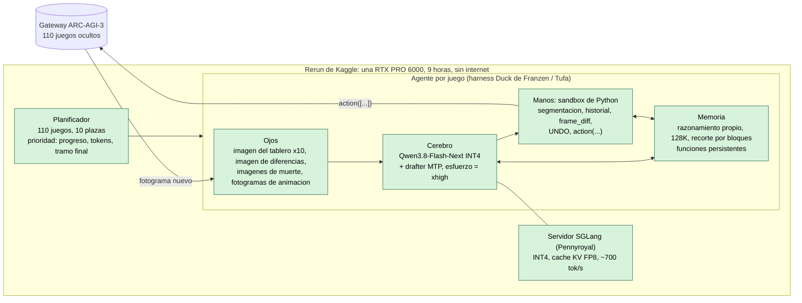
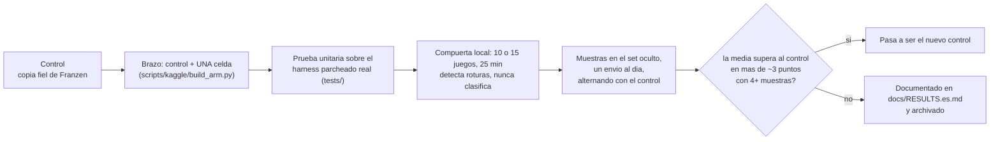

# Cómo funciona el sistema actual

[English](APPROACH.md) · [Volver al README](../README.es.md)

## La tarea, sencilla

Cada juego es una cuadrícula pequeña de celdas de colores. No hay instrucciones. El agente puede pulsar arriba / abajo / izquierda /
derecha / espacio, hacer clic en una celda o deshacer, y tiene que deducir las reglas **experimentando**, y luego resolver nivel tras
nivel. Un nivel completado en pocas acciones puntúa alto (comparado con las acciones de una persona); los niveles posteriores pesan
más; un nivel sin terminar vale cero. El set oculto tiene 110 juegos, una GPU y nueve horas en total: unos 50 minutos de una
«plaza» por juego.

## Las cinco partes

**1. El cerebro: un modelo grande hecho pequeño y rápido.**
Qwen3.8-Flash-Next es un modelo de «mezcla de expertos»: 125.000 millones de parámetros, pero solo unos 6.000 millones se usan en
cada token. Se comprime a números de 4 bits (INT4) para que quepa en la GPU de 96 GB, y un segundo modelo diminuto adivina varios
tokens por adelantado (*decodificación especulativa*, «MTP») para que el grande solo tenga que confirmarlos. Resultado: unos 700
tokens por segundo repartidos entre 10 juegos.

**2. Los ojos: lo que se le muestra al modelo.**
El tablero como imagen ampliada 10 veces; una segunda imagen que resalta *qué cambió* desde la última acción; imágenes extra cuando
se pierde un nivel; y cada fotograma intermedio de las animaciones como datos que puede leer desde código. Una segmentación
convierte el tablero en objetos (color, tamaño, posición, quién toca a quién).

**3. Las manos: Python en un sandbox.**
El modelo tiene una sola herramienta: ejecutar un fragmento de Python. Dentro ve el historial de la partida y puede llamar a
`action([...])` con uno o varios movimientos (incluido `UNDO`). Las funciones auxiliares que escribe **se conservan el resto de la
partida**, así que se va armando su propia caja de herramientas.

**4. La memoria: sus propios pensamientos, y nada más.**
El modelo conserva su razonamiento previo en el contexto (128K tokens). Cuando se llena, se descarta de golpe un bloque entero de
historia antiguo, lo que permite que la GPU reutilice su caché con el resto. El harness **no** escribe resúmenes ni notas al modelo
a propósito: en nuestras pruebas y en las del autor original, la prosa inyectada no ayudó.

**5. El controlador de tráfico: una GPU, 110 juegos.**
Solo 10 juegos pueden estar «pensando» a la vez. Una plaza se conserva hasta que se recorta el contexto del juego; entonces una
fórmula de prioridad decide quién la recibe, favoreciendo a los juegos que avanzan, no gastan tokens en vano o están cerca de
terminar un nivel. Hacia el final de las nueve horas la fórmula se inclina por los logros rápidos.

## Qué es nuestro y qué no

El agente en sí es la **solución pública del Milestone 2 de Daniel Franzen** (construida sobre el harness Duck de Tufa Labs), que
ejecutamos como copia fiel: reproduce ~26 en el set oculto. Lo nuestro es la *maquinaria de medición e iteración* alrededor:

- una copia de control más **brazos de una variable** (cada uno es un notebook que difiere del control en una sola celda), con el
  código de los parches probado contra el harness parcheado real (`tests/`);
- **corridas de diagnóstico** sobre los 15 juegos públicos que la demo de Franzen deja fuera, que mostraron que el set oculto es
  una mezcla de juegos que el modelo resuelve rápido y juegos donde apenas avanza (ver [RESULTS](RESULTS.es.md));
- **automatización de publicación y envíos**: imágenes de Kaggle fijadas, versiones de kernel, un enviador diario idempotente que
  espera al cupo y alterna control y candidato.

## Diagrama: el sistema

Verde = adoptado de la solucion publica y sin cambios. Todo lo que cambiamos o probamos cuelga de una de estas cajas; la tabla de abajo
dice que, y con que resultado.

## Diagrama: como iteramos

## Mapa de componentes: probado, probado por nosotros, sin probar

Leyenda: **adoptado** = solucion publica, usada sin cambios · **0 / − / +** nuestro veredicto en el oculto o en la compuerta · **construido** =
codificado y con pruebas unitarias, aun sin correr · **sin probar**.

| Parte | Componente | Estado |
|---|---|---|
| Servicio | SGLang + INT4 + drafter MTP, KV FP8, contexto de 128K | **adoptado** (el salto de ~3 a ~26) |
| | Escalas de KV FP8 calibradas; MTP con profundidad 4; 12 plazas; otros checkpoints (Swift, NVFP4 de NVIDIA, expertos podados) | **sin probar** (V2, V3, V9) |
| Ojos | Imagen del tablero x10, imagen de diferencias, imagenes de muerte, fotogramas de animacion como datos | **adoptado** |
| | Imagen de la cuadricula con etiquetas | **0** (pila vieja) |
| Manos | Sandbox de Python, segmentacion, `frame_diff`, UNDO | **adoptado** |
| | Funcion de efectos de acciones (S1), nota de grafo de estados (S2) | **0** (el puntaje lo limitan los niveles completados, no las acciones desperdiciadas) |
| Memoria / contexto | Razonamiento propio en la historia; recorte por bloques a 128K | **adoptado** |
| | Historia mas profunda con 8 plazas (D1) | **−** (−29 % de acciones) |
| | Notas escritas por el harness / secciones de modelo del mundo (7 variantes) | **0 / −** |
| | Funciones persistentes | **adoptado**; arreglos de robustez H1 **0** (seguros) |
| | Funciones auxiliares precargadas (M1) | **construido** |
| | Contexto nuevo tras un nivel estancado (C1, de heliosli) | **construido** |
| | Retencion de funciones con pruebas; conservar constantes literales | **sin probar** (V6, V7) |
| Razonamiento | `reasoning_effort=xhigh` (defecto de la plantilla) | **adoptado** |
| | `medium` (E1) | **−** (oculto 20,98 contra 25,7) |
| | `low`; esfuerzo adaptativo | **sin probar** (la corrida de `low` fallo dos veces por infraestructura) |
| Planificador | Compuerta de prioridad, 10 plazas | **adoptado** |
| | Prioridad D' (publica, una muestra 31,54) | **en curso** (alternando con el control) |
| | Primer tramo mas corto; mayor ocupacion de plazas | **0** (simulacion en CPU; el servidor ya esta saturado) |
| Entrenamiento | Ajuste fino, entrenamiento en tiempo de prueba, RL con los juegos publicos | **sin probar** (riesgo de contaminacion, sin presupuesto dentro de una corrida) |

## Mini-glosario

| Término | Significado |
|---|---|
| Mezcla de expertos (MoE) | Un modelo formado por muchas subredes especialistas; cada token usa solo unas pocas |
| INT4 | Pesos de 4 bits: un cuarto de la memoria de 16 bits, con poca pérdida de calidad |
| MTP / decodificación especulativa | Un modelo pequeño adelanta tokens; el grande los verifica en un solo paso |
| Caché KV | La memoria a corto plazo del modelo sobre la conversación; limita contexto × juegos en paralelo |
| Plaza (slot) | Uno de los 10 «hilos» de juego simultáneos que la GPU puede atender |
| Compuerta (gate) | Una corrida local corta (10 o 15 juegos, 25 min) para detectar cambios rotos; *no* para clasificarlos |
