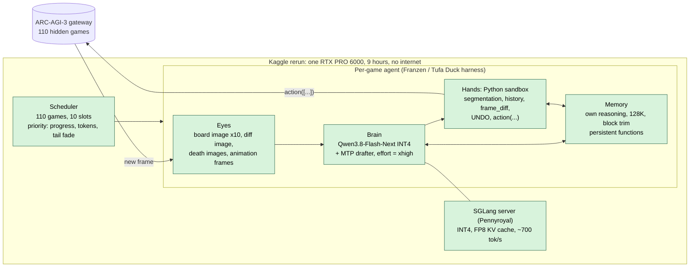
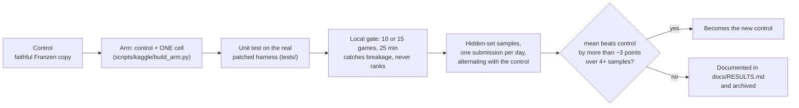

# How the current system works

[Español](APPROACH.es.md) · [Back to the README](../README.md)

## The task, simply

Each game is a small grid of colored cells. There are no instructions. The agent can press up / down / left / right / space,
click a cell, or undo — and it has to work out the rules **by experimenting**, then solve level after level. A level completed in
few actions scores high (compared with a human's action count); later levels weigh more; an unfinished level scores zero.
The hidden test set has 110 games, one GPU, and nine hours in total — about 50 minutes of one "slot" per game.

## The five parts

**1. The brain — a large model made small and fast.**
Qwen3.8-Flash-Next is a "mixture-of-experts" model: 125 billion parameters, but only about 6 billion are used for each token.
It is compressed to 4-bit numbers (INT4) so it fits in the 96 GB GPU, and a tiny second model guesses several tokens ahead
(*speculative decoding*, "MTP") so the big one only has to confirm them. Result: ~700 tokens per second shared by 10 games.

**2. The eyes — what the model is shown.**
The board as an image at 10× zoom; a second image highlighting *what changed* since the last action; extra images when a level is
lost; and every intermediate animation frame as data it can read from code. A segmentation turns the board into objects
(color, size, position, which touches which).

**3. The hands — Python in a sandbox.**
The model has one tool: run a Python snippet. Inside it sees the history of the game and can call `action([...])` with one or
several moves (including `UNDO`). Helper functions it writes are **kept for the rest of the game**, so it builds its own toolbox.

**4. The memory — its own thoughts, and nothing else.**
The model keeps its previous reasoning in context (128K tokens). When that fills up, a whole block of old history is dropped at
once, which lets the GPU reuse its cache for the rest. The harness deliberately does **not** write summaries or notes to the
model: in our tests and in the original author's, injected prose did not help.

**5. The traffic controller — one GPU, 110 games.**
Only 10 games can be "thinking" at the same time. A slot is kept until a game's context is trimmed; then a priority formula
picks who gets it next, favoring games that are progressing, not burning tokens, or close to finishing a level. Near the end of
the nine hours the formula shifts toward quick wins.

## What is ours, and what is not

The agent itself is **Daniel Franzen's public Milestone-2 solution** (built on Tufa Labs' Duck harness), which we run as a
faithful copy — it reproduces at ~26 on the hidden set. Our contribution is the *measurement and iteration machinery* around it:

- a control copy plus **one-variable arms** (each a notebook that differs from the control in a single cell), with the patch code
  tested against the real patched harness (`tests/`);
- **diagnostic runs** on the 15 public games Franzen's own demo leaves out, which showed the hidden set is a mix of games the
  model solves quickly and games where it barely progresses (see [RESULTS](RESULTS.md));
- publishing and **submission automation**: pinned Kaggle images, kernel versions, an idempotent daily submitter that waits for the
  quota and alternates control and candidate.

## Diagram: the system

Green = adopted from the public solution and unchanged. Everything we changed or tried sits on one of these boxes; the table below says
what, and with what result.

## Diagram: how we iterate

## Component map: proven, tried by us, untried

Legend: **adopted** = public solution, used unchanged · **0 / − / +** our hidden-set or gate verdict · **built** = coded and unit-tested, not yet
run · **untried**.

| Part | Component | Status |
|---|---|---|
| Serving | SGLang + INT4 + MTP drafter, FP8 KV, 128K context | **adopted** (the jump from ~3 to ~26) |
| | Calibrated FP8 KV scales; MTP depth 4; 12 slots; other checkpoints (Swift, NVIDIA NVFP4, expert-pruned) | **untried** (V2, V3, V9) |
| Eyes | 10x board image, diff image, death images, animation frames as data | **adopted** |
| | Labeled grid image | **0** (old stack) |
| Hands | Python sandbox, segmentation, `frame_diff`, UNDO | **adopted** |
| | Action-effects function (S1), state-graph note (S2) | **0** (score is limited by levels completed, not by wasted actions) |
| Memory / context | Own reasoning kept in history; block trimming at 128K | **adopted** |
| | Deeper history with 8 slots (D1) | **−** (−29 % actions) |
| | Harness-written notes / world-model sections (7 variants) | **0 / −** |
| | Persistent functions | **adopted**; robustness fixes H1 **0** (safe) |
| | Pre-seeded helper functions (M1) | **built** |
| | Fresh context after a stagnant level (C1, from heliosli) | **built** |
| | Test-gated function retention; keep literal constants | **untried** (V6, V7) |
| Reasoning | `reasoning_effort=xhigh` (template default) | **adopted** |
| | `medium` (E1) | **−** (hidden 20.98 vs 25.7) |
| | `low`; adaptive effort | **untried** (the `low` run failed twice on infrastructure) |
| Scheduler | Priority gate, 10 slots | **adopted** |
| | D' priority (public, one sample 31.54) | **running** (alternating with the control) |
| | Shorter first stint; fuller slot occupancy | **0** (CPU simulation; server already saturated) |
| Training | Fine-tuning, test-time training, RL on public games | **untried** (contamination risk, no budget inside a run) |

## Mini-glossary

| Term | Meaning |
|---|---|
| Mixture of experts (MoE) | A model made of many specialist sub-networks; each token uses only a few |
| INT4 | 4-bit weights: a quarter of the memory of 16-bit, small quality loss |
| MTP / speculative decoding | A small model drafts tokens ahead; the big model verifies them in one step |
| KV cache | The model's short-term memory of the conversation; it limits context length × parallel games |
| Slot | One of the 10 simultaneous game "threads" the GPU can serve |
| Gate | A short local run (10 or 15 games, 25 min) used to catch broken changes — *not* to rank them |
