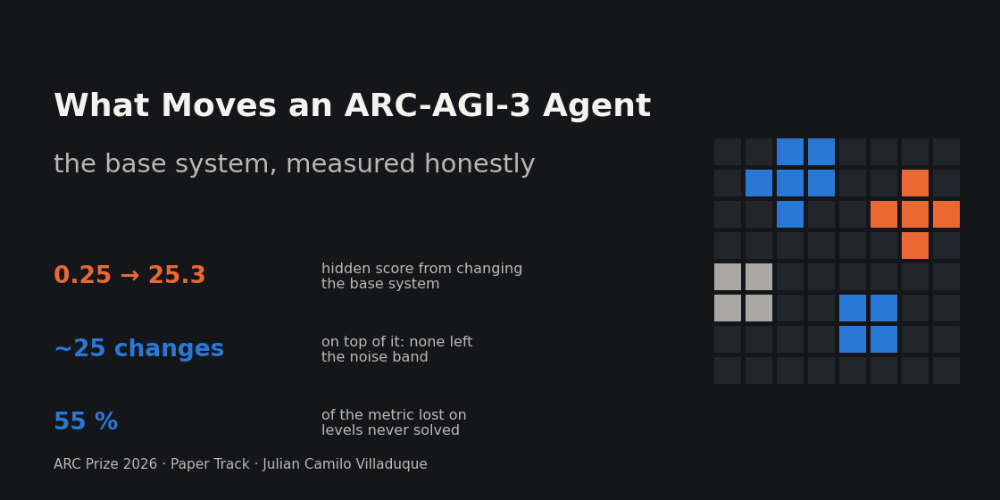
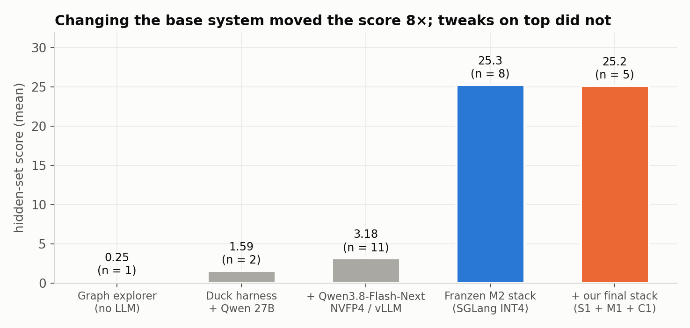
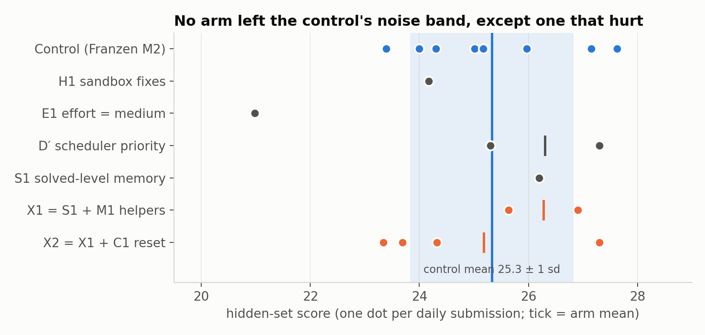
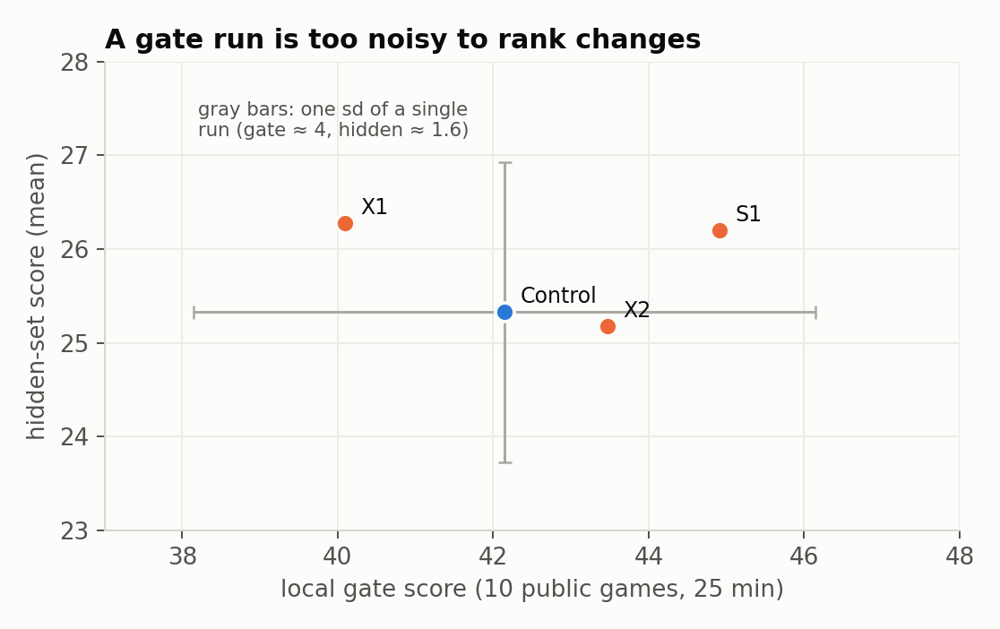
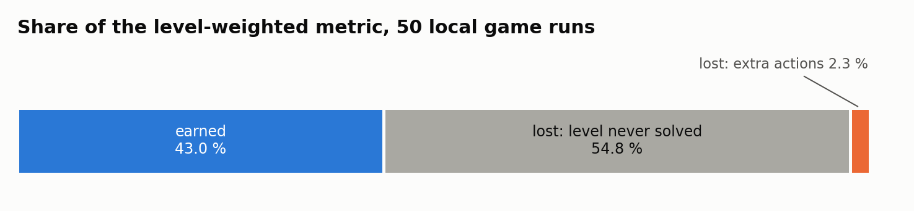
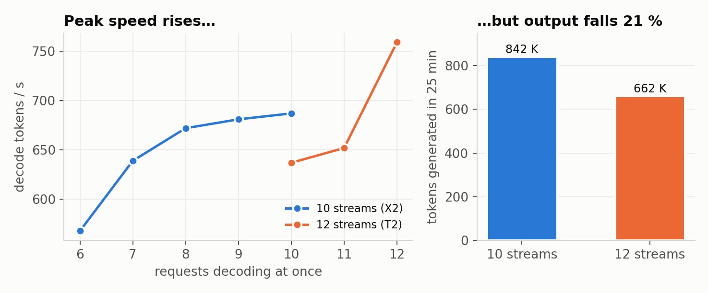

# Qué mueve a un agente de ARC-AGI-3: el sistema base, medido con honestidad

*ARC Prize 2026, Paper Track (ARC-AGI-3). Una reproducción fiel del mejor agente público, unos 25 cambios controlados sobre él,
y dónde se pierde de verdad la métrica.*

[English](WRITEUP.md) · [Volver al README](../README.es.md)

**Julian Camilo Villaduque** · ARC Prize 2026, ARC-AGI-3 · Mejor envío **27,63** (ID 56893893, notebook
[arc-agi3-franzen-m2](https://www.kaggle.com/code/juliancamilovilla/arc-agi3-franzen-m2)); pila final X2 con media 25,2 y mejor
envío 27,30 (ID 57924975, [arc-agi3-franzen-x2](https://www.kaggle.com/code/juliancamilovilla/arc-agi3-franzen-x2))

Código (MIT): https://github.com/jvilladuque90/arc-prize-2026-arc-agi-3

---

## En palabras sencillas

ARC-AGI-3 pone a un agente frente a pequeños videojuegos que nunca ha visto, sin instrucciones. Tiene que pulsar botones, mirar
qué pasa, deducir las reglas y superar los niveles. Cuantas menos acciones use, más puntos gana. Una persona lo logra en minutos.

Mi agente es un modelo de lenguaje que juega escribiendo pequeños programas en Python. Ve cada fotograma como imagen y recuerda
lo que ya probó. No inventé ese agente: lo publicó Daniel Franzen y lo copié exactamente. Después me hice una sola pregunta:
**¿qué cambios suben de verdad el score oculto y cuáles solo lo parecen?**

Mi aporte es un **método de medición** y un **diagnóstico**:

1. **La palanca es el sistema base.** Cambiar mi propio pipeline por el de Franzen me llevó de 3,2 a 25,3. Veinticinco ajustes
   cuidadosos encima no movieron nada fuera del ruido, y uno bajó el score tres desviaciones estándar.
2. **Los puntos se pierden en niveles que el agente nunca entiende, no en movimientos de más.** El 55 % del score se pierde en
   niveles nunca resueltos. Solo el 2 % se pierde en niveles resueltos con acciones de más.
3. **El servidor se queda sin memoria antes que sin cómputo.** Con más juegos en paralelo la GPU va más rápido en el pico, pero
   produce un 21 % menos de razonamiento.
4. **Las pruebas locales rápidas no pueden ordenar ideas.** Su ruido es mayor que cualquier efecto que perseguí.

Reporto cada experimento, negativos incluidos, para que el siguiente equipo no tenga que pagarlos otra vez.

---

## 1. El sistema

### 1.1 La base que copié

El control es una copia sin cambios del notebook del Milestone 2 de Franzen, construido sobre el harness de Tufa Labs.

| Parte | Qué hace |
|---|---|
| Modelo | Qwen3.8-Flash-Next, pesos INT4 AutoRound de Intel, borrador MTP de Albucino para decodificación especulativa |
| Servicio | Pennyroyal (fork de SGLang para la RTX PRO 6000): contexto de 128K, caché KV FP8 de 1,01 M tokens, 10 juegos decodificando a la vez |
| Agente | Conserva todo su razonamiento en la historia; actúa con una herramienta de Python; ve el tablero como imagen más los fotogramas de animación; lee cada game over en una imagen de diferencias; puede deshacer; conserva las funciones que escribe |
| Planificador | Da la GPU a los juegos con más progreso por token dentro de un presupuesto de 9 horas |

### 1.2 Lo que añadí

Cada añadido es una celda del notebook que parchea el harness por reemplazo exacto de texto. Cada uno tiene una prueba unitaria
contra el archivo real del harness.

| Brazo | Qué cambia | Origen |
|---|---|---|
| **S1** memoria de niveles resueltos | Al superar un nivel, sus hechos y una regla de una línea escrita por el modelo se fijan en el system prompt | `lalalia9` (CC-BY 4.0), a partir de `rellik13` |
| **M1** funciones sembradas | Cada juego empieza con 7 utilidades probadas, elegidas por lo que el modelo más reescribía en 70 registros | mío |
| **C1** reinicio por estancamiento | Tras 96K tokens atascado en un nivel, limpia una vez el contexto de razonamiento | `heliosli` |
| **H1** correcciones del sandbox | Conserva la biblioteca de funciones tras un timeout; limita salidas enormes | mío |
| **X1, X2** | X1 = S1 + M1; X2 = X1 + C1 (mi envío final) | — |

También probé cambios de servicio: borrador especulativo más profundo (T1), 12 juegos en paralelo (T2), menor esfuerzo de
razonamiento (E1) e historia más profunda (D1).

### 1.3 Cómo lo probé

- **Una variable por brazo, contra un control fiel.** Cada brazo difiere del control en una sola celda.
- **La compuerta local solo detecta roturas.** Es una corrida de 25 minutos en 10 juegos públicos. También registra la velocidad
  de decodificación y la aceptación especulativa, que se repiten al ~1 % y sirven para juzgar cambios de servicio.
- **Solo el conjunto oculto ordena.** Envié uno al día, comparé por juego con pruebas de signos y escribí cada regla de decisión
  antes de que llegara su resultado.

---

## 2. Resultados

### 2.1 El conjunto oculto

Las ocho muestras del control van de 23,4 a 27,6: media 25,3, desviación estándar 1,6. Con un envío al día, separar dos brazos
por 2 puntos pide unas 8 muestras de cada uno. Ningún brazo se acercó a tantas.

- **E1 empeoró.** Bajar el esfuerzo de razonamiento triplicó el score local en juegos difíciles y luego sacó 20,98 en el oculto.
- **Todo lo demás quedó dentro de la banda.** S1, D′ y X1 quedaron algo por encima de la media del control. X2, mi pila final,
  terminó en 25,2 con cinco muestras.

### 2.2 Por qué las pruebas locales no ordenan

Corridas idénticas de la compuerta difieren decenas de puntos por juego. Mi mejor compuerta del último mes, C1 con 50,7, habría
sido una pista falsa. Un banco local anterior llegó a estar anticorrelacionado con el oculto en cuatro brazos (r = −0,35).

### 2.3 Dónde se pierde el score

La métrica eleva al cuadrado el cociente entre acciones de referencia y acciones tomadas, por nivel, y pondera más los niveles
posteriores. Desglosé 50 partidas de compuerta por nivel. Los niveles resueltos ya puntúan casi completos: el 40 % del peso viene
de niveles resueltos dentro de la referencia. La pérdida está en los niveles nunca resueltos, normalmente los últimos, que pesan
más. En juegos públicos difíciles cada acción cuesta unos 2.200 tokens de razonamiento, frente a 600 en los fáciles. **La brecha
es lo rápido que el modelo entiende un juego nuevo**, no lo eficiente que se mueve.

### 2.4 El razonamiento lo limita la memoria

Si la pérdida está en niveles no entendidos, más razonamiento por juego debería ayudar. Así que intenté sacar más tokens del
servidor.

- **Borrador más profundo:** imposible. Los kernels de atención limitan los tokens borrador a 4.
- **12 juegos en paralelo:** la decodificación pico subió de 687 a 759 tokens por segundo. Luego el pool KV se llenó, hubo juegos
  desalojados y releídos, y la salida total bajó de 842 K a 662 K tokens.

La elección de Franzen de 10 juegos en paralelo está en el óptimo.

---

## 3. Por qué funciona, y por qué los ajustes no

Un juego de ARC-AGI-3 se resuelve adivinando una regla oculta, probando la conjetura con pocas acciones y corrigiéndola. Aquí
cada corrección se paga en tokens de razonamiento. Así que, a grandes rasgos:

**score ≈ (ciclos de hipótesis que recibe un juego) × (probabilidad de que un ciclo acierte)**

El sistema base sube ambos términos. El servicio rápido sube el número de ciclos. La historia larga, las imágenes de diferencias
y el código persistente hacen que cada ciclo parta de todo lo ya aprendido. Mis añadidos solo reorganizaban contexto que el
modelo ya tenía, así que no movieron ningún término. Los datos coinciden: la pérdida está en niveles nunca entendidos (§2.3) y el
número de ciclos lo limita la memoria KV (§2.4).

La lección vale para cualquier benchmark agéntico evaluado en un conjunto oculto: reproducir primero el mejor sistema público,
medir el mecanismo y dimensionar cada prueba frente al ruido antes de correrla.

## 4. Lecciones

1. **Contar las muestras antes de correr.** Con desviación estándar de 1,6 y una muestra al día, la mayoría de ideas no se pueden
   confirmar a tiempo. Hay que saberlo antes de gastar el envío.
2. **Medir el mecanismo, no el score.** Tokens por segundo, longitud aceptada y uso de KV se repiten al ~1 %. Resolvieron dos
   preguntas de servicio que las muestras de score nunca habrían resuelto.
3. **La infraestructura falla en silencio.** Tres de mis envíos dieron exactamente 0 cuando Kaggle dejó de fijar la variable de
   rerun. Seis compuertas murieron cuando los contenedores montaron las entradas con un layout de directorios antiguo. Ambas
   correcciones están en todos los notebooks.
4. **Las notas escritas por el harness no ayudan; las palabras del propio agente quizá sí.** Siete variantes de notas quedaron en
   la base o por debajo. El único añadido de texto con un informe público positivo, S1, es la regla del propio agente.

## 5. Qué probaría después

La brecha de 25 a los 70 de los líderes es velocidad de comprensión. No viene de la economía de acciones ni de la planificación.
Los candidatos que la atacan son un modelo más fuerte o más eficiente en tokens, escalas KV FP8 calibradas que liberen memoria
para más razonamiento, y un banco de repetición que juzgue cambios de servicio desde prompts guardados sin gastar envíos.

## Agradecimientos

A Daniel Franzen por publicar completa la solución del Milestone 2; a Tufa Labs por el harness; a John Pezzulli (Pennyroyal), Mamy
Ratsimbazafy y Gabriel Olympie por el trabajo en SGLang; a Intel (AutoRound) y Albucino (borrador MTP); a `lalalia9`, `rellik13` y
`heliosli` por S1 y C1; a la ARC Prize Foundation y a Kaggle.

Todos los números vienen de [docs/RESULTS.es.md](RESULTS.es.md). Las figuras las generan `scripts/make_writeup_figures.py` y
`scripts/make_cover.py`.
