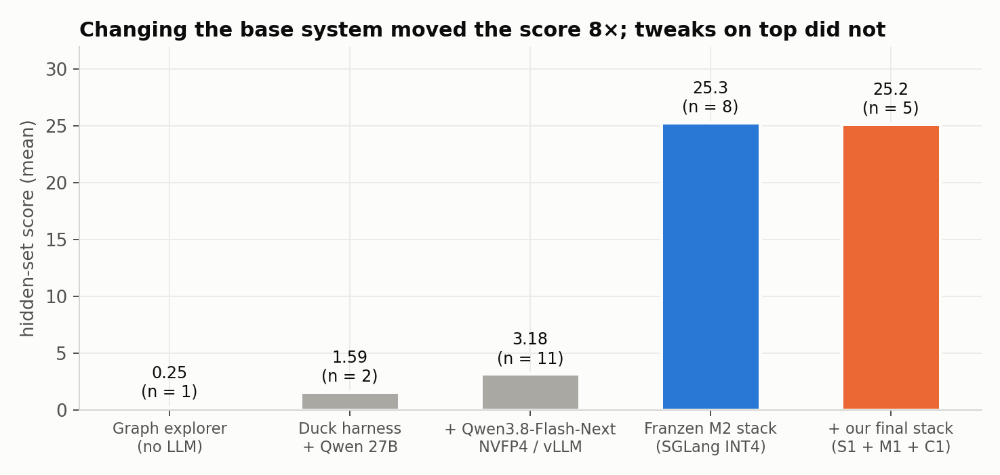
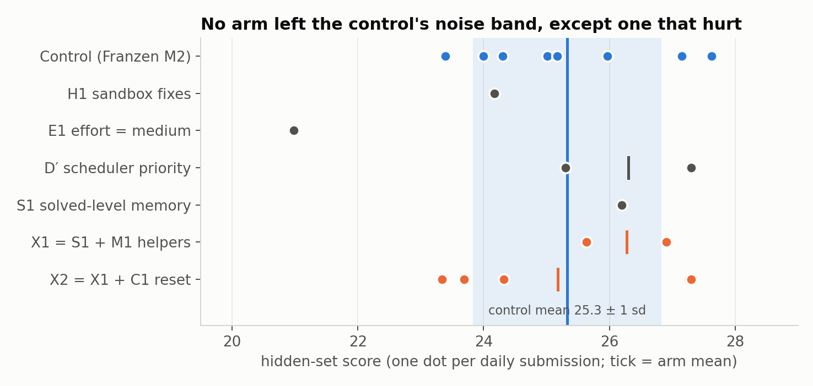
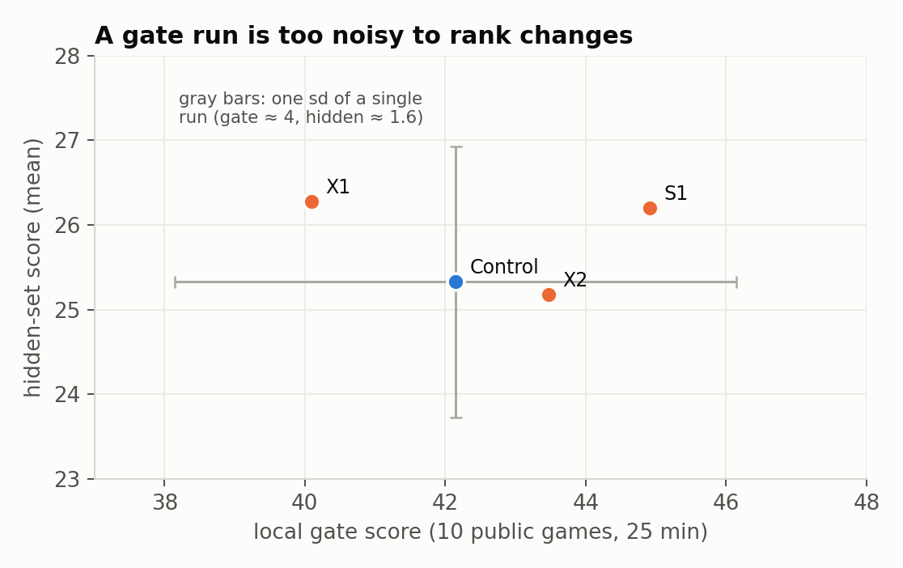
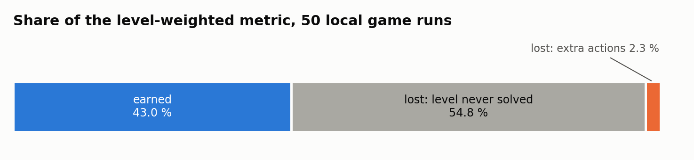
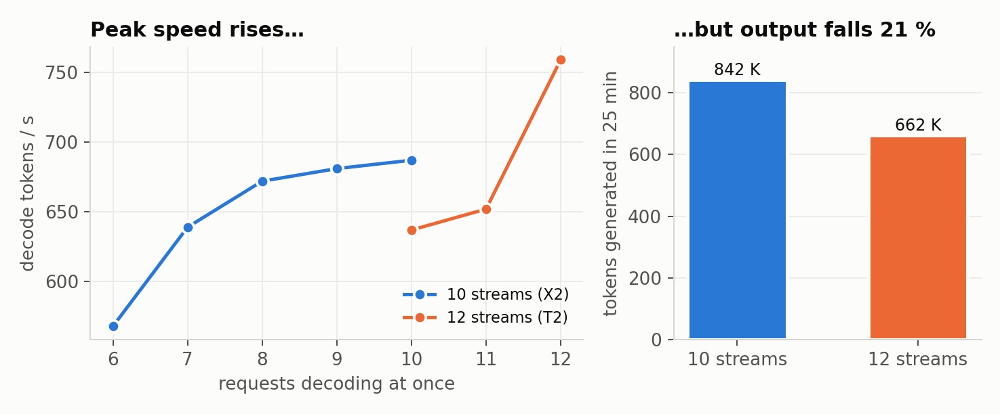

# What moves an ARC-AGI-3 agent: a base system, measured honestly

[Español](WRITEUP.es.md) · [Back to the README](../README.md)

**Team:** Julian Camilo Villa · **Competition:** ARC Prize 2026, ARC-AGI-3 (Kaggle) · **Final stack:** hidden-set mean 25.2 (n = 5); best submission 27.63 (control)
**Code:** this repository; every kernel is a one-cell variant of `notebooks/franzen_m2.ipynb`

## Summary

We spent three months on ARC-AGI-3, the interactive version of the benchmark, where an agent must discover the rules of unseen
games by acting. Our own pipeline peaked at a mean of 3.2. Adopting Daniel Franzen's public Milestone-2 solution as a faithful
control took us to 25.3. We then tested about 25 changes on top of a base, ten of them on the hidden set. None moved the score
outside the noise, and one lowered it by three standard deviations.

The useful results are about measurement rather than a new trick:

1. **The base system is the lever.** Serving speed, context length and memory set the ceiling; prompt-level additions did not.
2. **Local gates cannot rank changes.** A 10-game gate has a standard deviation of about 4 per run. Its ranking never matched the hidden set.
3. **The metric is lost on unsolved levels, not on extra actions.** 55 % of the level-weighted score is lost on levels the agent never
   solves. Only 2 % is lost on solved levels that took too many actions.
4. **The server is bound by KV memory, not compute.** More parallel games decode faster at peak but generate 21 % fewer tokens.

## 1. Approach

### 1.1 Base system

The control is an unmodified copy of Franzen's Milestone-2 notebook, which builds on Tufa Labs' harness:

- **Model:** Qwen3.8-Flash-Next with Intel's AutoRound INT4 weights and Albucino's MTP draft model for speculative decoding.
- **Serving:** Pennyroyal, an SGLang fork for the RTX PRO 6000, with a 128K context, an FP8 KV cache of 1.01 M tokens, and 10 games
  decoding in parallel.
- **Agent:** the model reasons with its full thinking kept in history. It acts through a Python tool. It sees the board as an upscaled
  image plus animation frames, and diagnoses each game over from a diff image. It can undo, and it keeps the helper functions it writes
  for the rest of the game.
- **Scheduling:** a priority gate gives the GPU to the games with the most progress per token. It fades the queue out over the last 20 %
  of the 9-hour budget.

The three public milestone winners share long retained history, an FP8 KV cache, observable game over and undo, and persistent
agent-written code. We took that shared core as the strongest prior available.

### 1.2 Our additions

Each addition is one notebook cell that patches the harness by exact-anchor replacement. Each one has a unit test against the real
harness file.

| Arm | What it changes | Source |
|---|---|---|
| **S1** solved-level memory | When a level is cleared, its facts and a one-line rule written by the model are pinned at the end of the system prompt | `lalalia9` (CC-BY 4.0), after `rellik13` |
| **M1** seeded helpers | Each game starts with 7 tested utilities, chosen from what the model rewrote most often in 70 saved logs | ours |
| **C1** stagnation reset | After 96K tokens on one unfinished level, clear the reasoning context once | `heliosli` |
| **H1** sandbox fixes | Keep the function library after a sandbox timeout; cap huge tool outputs | ours |
| **X1, X2** | X1 = S1 + M1; X2 = X1 + C1 (the final submission) | — |

We also tried serving changes: deeper MTP drafting (T1), 12 parallel games (T2), lower reasoning effort (E1) and deeper history (D1).

### 1.3 Protocol

- **One variable per arm, against a faithful control.** Each arm differs from the control in one cell.
- **A local gate only screens out breakage.** The gate is a 25-minute run on 10 public games. It also measures decode tokens per second
  and the speculative acceptance length, which repeat to about 1 % and so can judge serving changes.
- **Ranking comes only from the hidden set.** We submitted once per day, compared by game with sign tests, and wrote each decision rule
  down before its result arrived.

## 2. Results

### 2.1 Hidden set

The control's eight samples span 23.4 to 27.6, with a mean of 25.3 and a standard deviation of 1.6. At one submission per day, telling
two arms apart by 2 points needs about 8 samples each. No arm got close to that many.

- **E1 hurt.** Lowering the reasoning effort tripled the local score on hard games, then scored 20.98 on the hidden set.
- **Everything else stayed in the band.** S1, D′ and X1 sat slightly above the control mean. X2, our final stack, ended at 25.2 over five
  samples.

### 2.2 Why local gates cannot rank

Identical gate runs differ by tens of points on single games. The best gate of the final month, C1 at 50.7, would have been a false
lead. On the older pipeline the local bench was even anti-correlated with the hidden set across four arms (r = −0.35).

### 2.3 Where the score is lost

The metric squares the ratio of baseline actions to actions taken, per level, and weights later levels more. We split the 50 game runs
of our gates by level. Solved levels already score close to full: 40 % of the weight comes from levels solved in no more actions than
the baseline. The loss is on levels never solved, usually the later ones that weigh most. A diagnostic run on the 15 public games
outside Franzen's demo shows the same thing. The first level takes 2.6 minutes on easy games and 11.6 minutes on hard ones, and each
action costs about 600 reasoning tokens against 2,200. The gap is how fast the model understands a new game.

### 2.4 Throughput is capped by memory

If unsolved levels are the loss, more reasoning tokens per game should help, so we pushed the server.

- **Time:** the 9-hour budget is already used in full, and loading 185 GB of model files at Kaggle's input bandwidth costs 15 to 28 minutes.
- **Deeper MTP drafting:** impossible. The attention kernels cap draft tokens at 4.
- **12 parallel games:** peak decode rose from 687 to 759 tokens per second. The KV pool then saturated, games were evicted and
  re-prefilled, and total output fell from 842 K to 662 K tokens.

Franzen's configuration of 10 parallel games sits at the optimum.

## 3. Lessons

1. **Start from what the top public solutions share,** and change one thing at a time against a faithful copy.
2. **Count the samples before running.** With a standard deviation of 1.6 and one sample per day, most ideas cannot be confirmed in
   time. Know that before spending the submission.
3. **Instrument the mechanism, not the score.** Tokens per second, acceptance length and KV usage repeat to about 1 %. They settled two
   serving questions that score samples never could.
4. **Infrastructure fails silently.** Three submissions scored exactly 0 when Kaggle stopped setting the rerun variable. Six gates died
   when containers mounted inputs in an older directory layout. Both fixes are in every notebook (`docs/RESULTS.md` §3.1).
5. **Harness-written notes do not help; the agent's own data might.** Seven note-writing variants all scored at or below the base. The
   only text addition with a public positive report, S1, is the agent's own rule.

## 4. What we would try next

The remaining gap, from 25 to the 70s of the leaders, is speed of understanding. It does not come from action economy or scheduling.
The candidates that address it are a stronger or more token-efficient model, calibrated FP8 KV scales, and a replay bench that judges
serving changes from saved prompts without spending submissions.

## Acknowledgements

Daniel Franzen for publishing the Milestone-2 solution in full, and Tufa Labs for the harness it builds on. John Pezzulli (Pennyroyal),
Mamy Ratsimbazafy and Gabriel Olympie for the SGLang work. Intel for the AutoRound weights and Albucino for the MTP draft. `lalalia9`
and `rellik13` for the solved-level memory, and `heliosli` for the stagnation reset. The ARC Prize Foundation and Kaggle for running
the competition.

All numbers come from [docs/RESULTS.md](RESULTS.md). The figures are generated by `scripts/make_writeup_figures.py`.
